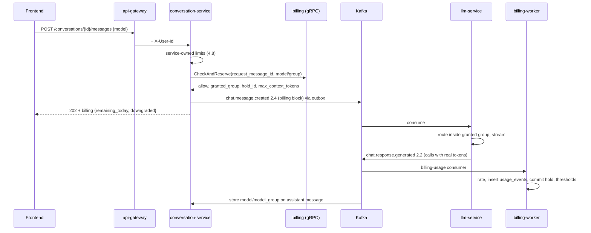
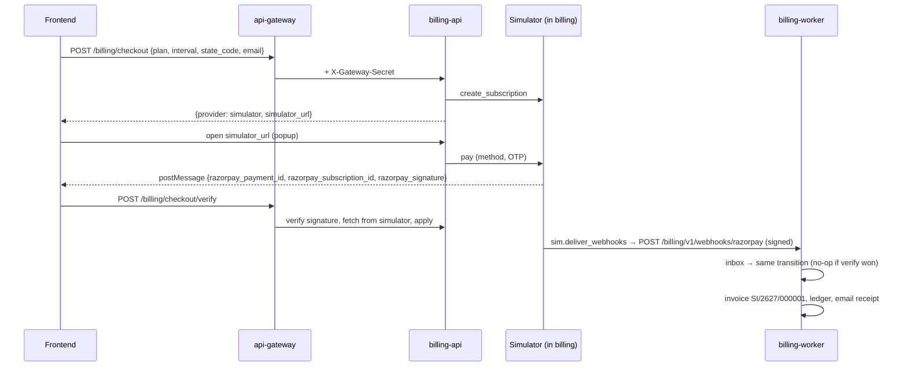
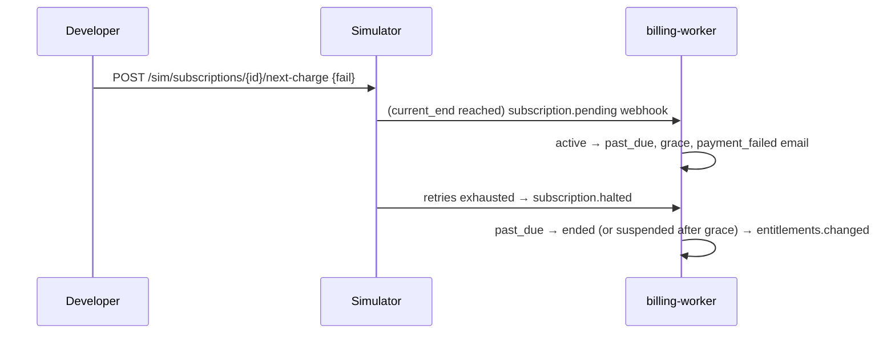
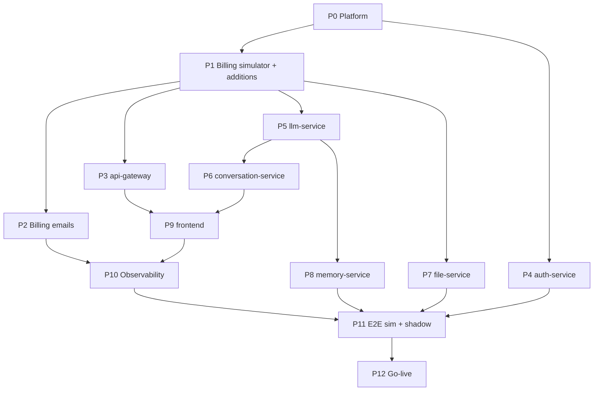

# GranthanAI: billing integration plan across services

**Status:** plan, as of 8 Nov 2026. **Owner:** Soubhagya Srivastava.
**Scope:** connecting `billing-service` (code-complete for v1, with v2 and v3 behind flags) to every other GranthanAI service; adding a Razorpay simulator to billing, switched by one environment variable; and rolling out from simulation to real money.

The billing internals (state machines, ledger, GST, Lua scripts) are specified in `billing-service/docs/hld.md` and `docs/lld.md`. This document is the source of truth for **how other services talk to billing**. Where the two disagree on an integration point, this document wins. Raise the conflict in the phase report.

---

## 0. How to use this document

- **Phases.**
  - **Order:** phases are numbered in dependency order. Phases in the same "track" (section 8) can run in parallel.
  - **One phase, one repo:** each phase belongs to exactly one repo, except P0 and P11.
  - **One writer:** run **one agent session per repo** at a time. Two writers in one folder caused the surprise edits and pushes during billing Stage G.
- **Agent prompts.** Give an agent the phase section, plus section 4 (contracts), plus section 5 if it touches payments. Every phase has an **Exit check**; a phase is done only when it passes.
- **Contracts are frozen per phase.** If a phase needs a contract change, change section 4 here first, then every producer and consumer, in that order.
- **Additive changes only** to existing events and APIs: new optional fields, new topics, new routes. A consumer must ignore unknown fields. No renames, and no repurposing of a field's meaning.
- **Every money-relevant change carries tests.**
  - **Unit:** for the logic.
  - **Integration:** with real Postgres, Valkey and Kafka through Testcontainers.
  - **Simulation:** at least one end-to-end scenario run against the billing simulator (section 5).

---

## 1. Goals and non-goals

**Goals (v1 launch: Free, Pro, Max individual plans)**
1. Every chargeable action anywhere on the platform is checked against the user's plan **before** it runs, and recorded **exactly once** after it runs.
2. Every rupee of provider cost (LLM tokens, Manim render compute, YouTube transcript egress) is attributed to a user and a plan. Nothing is silently unmetered.
3. Users can see their plan, limits and usage, pick models, pay, renew, upgrade, downgrade, cancel and get invoices.
4. All of this is fully developable and testable **without Razorpay credentials**, through a faithful simulator, and switching to real Razorpay is a config change plus a runbook.
5. If billing is unavailable, the platform degrades predictably: cheap actions continue under a small cap, expensive ones stop.

**Non-goals for this plan:**
- org-service and organisation pilots (v2, phase P13).
- The Pay as you Go wallet UI (v3, phase P14).
- An admin console UI (P15). The admin API is used through scripts until then.
- Scale-out work (ClickHouse, Temporal, Hyperswitch, a second gateway).

---

## 2. Current state (repos checked on 8 Nov 2026)

| Service | Last commit | Billing-relevant facts today | Integration status |
| --- | --- | --- | --- |
| **billing-service** | `7eef6c1` (8 Nov) | v1 complete; v2 (orgs) and v3 (wallet) behind `PAYG_ENABLED`. REST under `/billing/v1/*`, gRPC `BillingInternal` on 50051. Kafka events are JSON. `PAYMENT_GATEWAY` = `razorpay` or `fake`; **the fake is in-memory**, so it can't serve the API and worker as separate processes. | Needs the simulator, plus small integration additions (P1, P2) |
| **api-gateway** | `cfe4bc9` (28 Oct) | Explicit route modules; `reverse_proxy` forwards the raw body; strips client `x-user-id` and sets it from the JWT. **Does not strip `x-staff-role`.** `PUBLIC_PATHS` uses **substring matching**, an auth-bypass bug. No billing routes. | P3 |
| **auth-service** | `a8a4ac8` (28 Oct) | JWT with `sub`, `jti` and `exp`; **no roles claim**. SMTP `EmailSender` and an outbox publisher exist. **No account deletion** and no `user.deleted` event. | P4 |
| **llm-service** | `626020e` (7 Nov) | Groq, Gemini and NVIDIA adapters; one global `GENERATION_PROVIDER_ORDER`. `chat.response.generated` schema **2.1** with no `hold_id` or `calls`. **Completion tokens counted as characters** in `streaming_service.py`. Request analyzer calls Groq. Manim jobs through internal `POST /manim/jobs`. Web search uses only free providers (DuckDuckGo, SearXNG, Wikipedia, arXiv, OpenAlex, StackExchange, Wikidata); `tavily_api_key` is configured but unused. | P5 |
| **conversation-service** | `988df1b` (28 Oct) | Publishes `chat.message.created` schema **2.3** through an outbox. Owns messages, branches, custom modes, preferences, document attachments and artifacts (Manim, via llm-service). No billing calls. | P6 |
| **file-service** | `4aa4a21` (1 Nov) | Uploads (100 MB global cap), YouTube transcript sources (`youtube-transcript-api`, an optional paid egress proxy `YOUTUBE_PROXY_URL`, 20 per user per hour). Events `file.*`. No plan-based limits, no `file.youtube.ingested`, no storage-usage endpoint. | P7 |
| **memory-service** | `c3db5de` (7 Nov) | **Makes paid LLM calls** (Groq `openai/gpt-oss-20b`) for summaries (every 20 messages) and fact extraction, triggered by `memory.update.requested` from llm-service. No usage reporting. No per-plan fact cap. | P8 |
| **granthan-frontend** | `3982e2b` (1 Nov) | React 19, TanStack Query, zustand, Tailwind, Vitest; `ToolPicker` and per-conversation mode store patterns. No billing UI. | P9 |
| **retrieval-service** | `92e79f7` (7 Nov) | No paid external calls. | None needed |
| **graph-service** | `130dcc9` (1 Nov) | No paid external calls. | None needed |
| **embedding-service** | `fb91bc9` (7 Nov) | Local models (all-MiniLM-L6-v2 plus a local reranker). Fixed infrastructure cost, not per call. | None needed (see 4.9) |
| **org-service** | does not exist | Contract in `billing-service/contracts/org-service.md`. | P13 (v2) |
| **notification-service** | does not exist | Billing sends its own transactional emails (P2). | None needed for v1 |
| **admin-console** | does not exist | Billing admin API is ready. | P15 |

---

## 3. Target architecture

```mermaid
flowchart LR
  FE[granthan-frontend] -->|HTTPS + JWT| GW[api-gateway]
  RZP[Razorpay or simulator] -->|signed webhooks| GW
  GW -->|X-Gateway-Secret, X-User-Id, X-Staff-Role| BILL[billing-api :8080]
  GW --> CONV[conversation-service]
  GW --> FILE[file-service]
  GW --> AUTH[auth-service]
  CONV -->|gRPC CheckAndReserve / Release / GetEntitlements| BILLG[billing-api gRPC :50051]
  FILE -->|gRPC CheckAndReserve / GetEntitlements| BILLG
  LLM[llm-service] -->|gRPC CheckAndReserve (Manim)| BILLG
  MEM[memory-service] -->|gRPC GetEntitlements| BILLG
  CONV -->|chat.message.created + billing block| K[(Kafka)]
  K --> LLM
  LLM -->|chat.response.generated / cancelled, artifact.manim.rendered| K
  FILE -->|file.youtube.ingested| K
  MEM -->|usage.metered| K
  AUTH -->|user.deleted| K
  K --> WORK[billing-worker]
  WORK -->|subscription.changed, entitlements.changed, invoice.issued, ...| K
  K --> CONV
  K --> FILE
  K --> MEM
  WORK -->|SMTP| MAIL[(Email)]
  BILL --- PG[(Postgres billing)]
  BILL --- VK[(Valkey billing)]
  WORK --- PG
  WORK --- VK
```

**Responsibilities:**

| Concern | Owner | Notes |
| --- | --- | --- |
| Plans, prices, limits, models catalog | billing (`config/plans.yaml`) | The single list of models; llm-service checks its adapters against it |
| Daily and monthly counters, model access, credits | billing (`CheckAndReserve`) | Atomic Valkey scripts |
| Non-counter limits (branches, facts, storage, …) | The service that owns the data | Reads limits from `GetEntitlements` (4.7, 4.8) |
| Usage and cost recording | billing worker | From Kafka events only; never from synchronous calls |
| Which model actually answers | llm-service | Inside the group billing granted; never escalates |
| Payments, invoices, GST, ledger | billing | The gateway is Razorpay or the simulator |
| Identity, staff roles, account deletion | auth-service | JWT claims; `user.deleted` |
| Billing emails | billing worker | Through the `EmailSender` port (P2) |

---

## 4. Cross-cutting contracts

### 4.1 Identity and trust

| Hop | Mechanism | Rule |
| --- | --- | --- |
| Browser → gateway | JWT (auth-service) | Unchanged |
| Gateway → billing REST | `X-Gateway-Secret` (billing `GATEWAY_SHARED_SECRET`, comma-separated for rotation) | **Required** on every billing route except `/billing/v1/plans`, `/billing/v1/models`, `/billing/v1/webhooks/razorpay`, `/billing/v1/sim/checkout/*` (simulation only) and the health and metrics routes. Billing refuses to start without it. |
| Gateway → any service | `X-User-Id` from JWT `sub` | The gateway strips any client-sent `x-user-id` (already done) **and `x-staff-role` and `x-gateway-secret`** (P3) |
| Gateway → billing admin | `X-Staff-Role` from JWT `roles` (P4) | Only `support` (read) and `billing_admin` (write). Set only on `/billing/admin/*` |
| Service → billing gRPC | `authorization: Bearer <service token>` | One token per calling service, all listed in billing `SERVICE_TOKEN_KEYS`. Tokens: `CONV_BILLING_TOKEN`, `FILE_BILLING_TOKEN`, `LLM_BILLING_TOKEN`, `MEM_BILLING_TOKEN` |
| Billing → other services' internal HTTP | `Authorization: Bearer <service token>` | file-service storage usage (v3), org-service (v2) |
| Razorpay → billing | HMAC SHA256 of the raw body (`X-Razorpay-Signature`) | The gateway must forward the **raw bytes unchanged**. It already reads `request.body()` and forwards bytes; P3 adds a test |

**Correlation:** the gateway sets `X-Correlation-ID`. Every service passes it on as gRPC metadata `x-correlation-id` and as Kafka header `correlation_id`, and logs it.

### 4.2 Idempotency keys (what makes "exactly once" work)

| Action | Reserve `idempotency_key` | Usage `source_id` in billing | Who generates it |
| --- | --- | --- | --- |
| Chat message | `request_message_id` | `request_message_id` | conversation-service (UUIDv7 per send) |
| Regenerate | new `request_message_id` | new `request_message_id` | conversation-service |
| Manim render | `"{job_id}:{attempt}"` | `"{job_id}:{attempt}"` | llm-service (`attempt` starts at 1, +1 per retry) |
| YouTube source | `"{document_id}:{attempt}"` | `"{document_id}:{attempt}"` | file-service (`attempt` +1 per retry route call) |
| Memory LLM work (cost only) | none (no reserve) | the event's `event_id` | memory-service |
| Storage month (v3) | none | `"storage:{account}:{yyyymm}"` | billing |

> **Why the attempt suffix:** billing deduplicates usage on `(kind, source_id)`. Without the attempt suffix, a retried render or import that succeeds after a failed first try would be dropped as a duplicate and never billed. **Billing change in P1:** read `attempt` from `artifact.manim.rendered` and `file.youtube.ingested`, defaulting to 1.

### 4.3 Kafka topic catalog

Partitions: 6 in production, 1–3 locally. Retention: 7 days. Keys keep per-entity order.

| Topic | Producer | Consumers | Key | Schema |
| --- | --- | --- | --- | --- |
| `chat.message.created` | conversation-service | llm-service | conversation_id | **2.4** (adds `billing` block, 4.4.1) |
| `chat.response.generated` | llm-service | conversation-service, billing (`billing-usage`) | conversation_id | **2.2** (adds `hold_id`, `model_group`, `model`, `downgraded`, `calls`) |
| `chat.response.cancelled` | llm-service | conversation-service, billing | conversation_id | adds the same billing fields |
| `memory.update.requested` | llm-service | memory-service | conversation_id | add optional `request_message_id` (lets memory costs link to a message) |
| `artifact.manim.rendered` | llm-service | billing | user_id | 1.0 (new), 4.4.3 |
| `file.youtube.ingested` | file-service | billing | user_id | 1.0 (new), 4.4.4 |
| `usage.metered` | memory-service (and any future paid caller) | billing | user_id | 1.0 (new), 4.4.5 |
| `user.deleted` | auth-service | billing, conversation-service, file-service, memory-service (their own cleanup) | user_id | 1.0 (new), 4.4.6 |
| `subscription.changed` | billing | frontend (via conversation-service SSE, later), notification | billing_account_id | billing 1.0 |
| `entitlements.changed` | billing | conversation-service, file-service, memory-service, llm-service | user_id | 1.0 (new, P1), 4.4.7 |
| `usage.threshold_reached` | billing | conversation-service (to push an SSE notice) | user_id | billing 1.0 |
| `payment.failed`, `invoice.issued`, `subscription.renewal_upcoming` | billing | billing's own email jobs (P2) | billing_account_id | billing 1.0 |
| `storage.payment_required` (v3) | billing | file-service | user_id | billing 1.0 |
| `billing.usage.dlq`, `billing.user.dlq`, `billing.org.dlq` | billing | humans plus `billing.cli dlq replay` | original | original bytes |

Every topic is created by the platform topics script (P0). No service relies on automatic topic creation.

### 4.4 Event schemas (JSON)

**Common rules:**
- Timestamps are ISO 8601 UTC with a `Z` suffix.
- IDs are UUID strings.
- Money is integer paise; cost is integer micro-rupees.
- Token counts are integers ≥ 0, **as reported by the provider**.
- Consumers ignore unknown fields.

#### 4.4.1 `chat.message.created`, schema 2.4: the `billing` block (conversation-service → llm-service)

```json
"billing": {
  "hold_id": "0193...",
  "requested_model": "claude-sonnet-5-5",
  "granted_group": "best",
  "granted_model": "claude-sonnet-5-5",
  "max_context_tokens": 128000,
  "funded_by": "plan",
  "downgraded": false,
  "enforcement": "enforce",
  "allowed_models": ["claude-sonnet-5-5", "gpt-6.1-sol"]
}
```

- `hold_id`: null in degraded mode, or after a shadow-mode deny.
- `requested_model`: null means Auto.
- `granted_model`: null means llm-service picks a model inside the group.
- `allowed_models` (additive, optional): the catalog ids the user's plan allows **inside `granted_group`**, taken by
  conversation-service from the cached `GetEntitlements.allowed_models` (every group together) and filtered to the granted
  group. llm-service builds the chain as `granted_model` (if it is in the list), then the group's order filtered to the
  list, and never anything else; an empty result is an error event with the calls so far (billing releases the hold).
  Omitted when billing is off, in shadow and degraded mode, when the entitlements are unknown, and when credits pay for the
  message (`funded_by: credits`: the plan does not govern what credits buy). Absent = the whole group, as before.
- A request for an Advanced model after the daily Advanced allowance is allowed and downgraded: `granted_group` is `smart`,
  `downgraded` true, `message_key` `limit.best_switched`, and `granted_model` is a Smart model the plan includes (or empty),
  never the Advanced model that was asked for.
- `funded_by`: `plan` or `credits`.
- `enforcement`: `enforce`, `shadow` or `degraded`.
- **Block absent, or `granted_group` null:** llm-service uses its legacy routing.

#### 4.4.2 `chat.response.generated`, 2.2 and `chat.response.cancelled` (llm-service → billing): added fields

```json
"hold_id": "0193...",
"model_group": "best",
"model": "claude-sonnet-5-5",
"downgraded": false,
"calls": [
  {"provider": "anthropic", "model": "claude-sonnet-5-5", "purpose": "answer",
   "input_tokens": 6000, "cached_input_tokens": 0, "output_tokens": 700, "usage_estimated": false},
  {"provider": "groq", "model": "openai/gpt-oss-20b", "purpose": "request_analysis",
   "input_tokens": 2000, "cached_input_tokens": 0, "output_tokens": 250, "usage_estimated": false}
]
```

- **`model`:** always the catalog model ID that actually answered, after any fallback inside the group.
- **`purpose`** ∈ `answer`, `request_analysis`, `query_rewrite`, `workflow`, `research`, `manim_plan`.
- **On error:** `status = "error"`, and `calls` lists every call made so far; billing releases the hold and records the cost.
- **On cancel:** if every call has `output_tokens == 0`, billing releases the hold. Otherwise the message counts as used.

#### 4.4.3 `artifact.manim.rendered` 1.0 (llm-service → billing)

```json
{"event_type": "artifact.manim.rendered", "schema_version": "1.0", "event_id": "…", "occurred_at": "…",
 "user_id": "…", "job_id": "…", "attempt": 1, "hold_id": "… or null", "status": "success|error",
 "calls": [ /* manim_plan and repair calls, same shape as 4.4.2 */ ]}
```

Billing adds render compute (`MANIM_RENDER_COST_USD`, default 0.01) to the cost.

#### 4.4.4 `file.youtube.ingested` 1.0 (file-service → billing)

```json
{"event_type": "file.youtube.ingested", "schema_version": "1.0", "event_id": "…", "occurred_at": "…",
 "user_id": "…", "source_id": "<document_id>:<attempt>", "document_id": "…", "attempt": 1,
 "hold_id": "… or null", "status": "success|error", "proxy_bytes": 0}
```

`proxy_bytes` is optional. Billing uses `YOUTUBE_INGEST_COST_INR` per video today; P7 records the bytes so the constant can be checked against the proxy bill later.

#### 4.4.5 `usage.metered` 1.0, generic cost-only metering (any service that calls a paid API)

```json
{"event_type": "usage.metered", "schema_version": "1.0", "event_id": "…", "occurred_at": "…",
 "producer": "memory-service", "user_id": "…", "conversation_id": "… or null",
 "request_message_id": "… or null", "feature": "memory.summary|memory.facts|…",
 "calls": [ /* same shape as 4.4.2; purpose = feature */ ],
 "fixed_cost_micro_inr": 0}
```

- **Billing (P1):** stores it as a `usage_events` row with `kind = "aux"`, `source_id = event_id`, `price = 0` and `units = 0`. The cost is rated by the price book at `occurred_at`, plus `fixed_cost_micro_inr`.
- **It never touches counters or holds.**
- **Unknown model:** the event goes to the DLQ, the same as chat usage.

> **Rule for the future:** any new code path in any service that calls a paid external API must emit either a reserve-and-usage pair (if the user should be limited) or a `usage.metered` event (if it's cost only). A PR that adds a paid call without one is rejected. This is the "nothing is unmetered" guarantee.

#### 4.4.6 `user.deleted` 1.0 (auth-service → many)

```json
{"event_type": "user.deleted", "schema_version": "1.0", "event_id": "…", "occurred_at": "…", "user_id": "…"}
```

#### 4.4.7 `entitlements.changed` 1.0 (billing → services that cache entitlements), new in P1

```json
{"event_type": "entitlements.changed", "schema_version": "1.0", "event_id": "…", "occurred_at": "…",
 "producer": "billing-service", "user_id": "…", "reason": "subscription|override|block|org|wallet|catalog",
 "version_hash": "sha256:…"}
```

Emitted through the outbox in the same transaction as the change, for every user whose entitlement may change. For an org change, one event per member.

### 4.5 gRPC `BillingInternal`

- **Proto:** `billing-service/proto/granthan/billing/v1/billing.proto` is the source.
  - Callers **vendor** a copy into `proto/billing/` with the billing commit hash in a header comment, and generate stubs with their own tooling.
  - Re-vendor whenever billing bumps the proto. Billing guarantees additive changes only (`make proto-check`).
- **RPCs:** `CheckAndReserve`, `Release`, `GetEntitlements`.
- **Caller rules** (the same in every service):

| Rule | Value |
| --- | --- |
| Deadline | `CheckAndReserve` 150 ms · `Release` 500 ms × 3 retries · `GetEntitlements` 300 ms |
| Circuit breaker | Opens after 5 consecutive failures or timeouts; half-open after 30 s |
| Degraded behaviour (breaker open) | See the per-service phases. **Never** allow Best or Ultra, or anything paid per unit, while degraded |
| Metadata | `authorization`, `x-correlation-id` |

### 4.6 Billing deny error shape (used by every user-facing service)

```json
{"detail": {"code": "billing_denied", "reason": "daily_limit", "message_key": "limit.daily",
            "message": "Daily limit reached. Resets at midnight, or upgrade / top up.",
            "resets_at": "2026-11-09T00:00:00+05:30", "upgrade_to": "max"}}
```

| reason | HTTP | message_key | English message (Limit Behaviour sheet) |
| --- | --- | --- | --- |
| `daily_limit` | 429 | `limit.daily` | Daily limit reached. Resets at midnight, or upgrade / top up. |
| `monthly_limit` | 429 | `limit.monthly` | You've used this month's allowance. It resets on the 1st, or upgrade. |
| `model_not_in_plan` | 403 | `plan.model_not_included` | This model isn't included in your plan. |
| `account_blocked` | 403 | `account.blocked` | Your account can't send messages right now. Please contact support. |
| `no_credit` | 402 | `credits.empty` | Top up to continue. |
| `spend_cap` | 402 | `credits.spend_cap` | Monthly spend cap reached. Sending is paused until the cap is raised or next month. |
| `member_spend_cap` | 402 | `credits.member_cap` | Your organisation's monthly limit for you has been reached. Ask your organisation admin to raise it. |
| `billing_unavailable` | 503 | `billing.degraded` | Only Fast models are available for a few minutes. Please try again shortly. |
| `plan_limit` (non-counter limits, 4.8) | 403 | `limit.<name>` (for example `limit.branches_per_tree`) | "<What> limit for your plan reached. Upgrade to add more." |

Allowed-but-downgraded responses carry `notice_key: "limit.best_switched"` ("Today's Advanced answers are used, so this one comes from a Smart model.").

### 4.7 Entitlement distribution

- **Read path:** services call `GetEntitlements(user_id)` and cache the result **per user for 60 s** (in process, or in their own Redis).
- **Invalidation:** consume `entitlements.changed` (P1) and drop that user's cache entry. On `user.deleted`, drop it too.
- **Billing unreachable:** use the cached value for up to 1 hour, then Free limits.
- **Downgrade policy** (from the HLD): never delete user data when limits shrink.
  - Content over the new limit becomes **read-only**: no new branches in an over-limit tree, no new facts beyond the cap, no new uploads beyond storage.
  - Show the plan-limit message.
- `-1` means unlimited in every limit.

### 4.8 Limits enforcement matrix (every plan limit has exactly one enforcer)

| Limit (`plans.yaml`) | Free / Pro / Max | Enforced by | Where and when |
| --- | --- | --- | --- |
| `messages_per_day` | 25 / 60 / 80 | **billing** (`CheckAndReserve`) | Before every send and regenerate, in conversation-service |
| `best_per_day` | 0 / 0 / 12 | **billing** | Same call; Max's 13th Best becomes Smart, with a notice |
| Model access (`groups` + `extra`) | Fast + gpt-oss-120b / Fast + Smart / Fast + Smart + Best | **billing** | Same call |
| `context_tokens` | 16k / 64k / 128k | **llm-service** | From `billing.max_context_tokens` |
| `youtube_per_month` | 3 / 20 / 60 | **billing** (`CheckAndReserve`, kind `YOUTUBE_VIDEO`) | file-service, before creating a YouTube source and before a retry |
| Manim renders | unlimited on plans (priced on credits) | **billing** (`CheckAndReserve`, kind `MANIM_VIDEO`) | llm-service `create_job` |
| `messages_per_conversation` | 50 / 200 / 500 | **conversation-service** | Before the reserve call (no billing count spent on a refused send) |
| `branches_per_tree` | 20 / 200 / unlimited | **conversation-service** | When a send or regenerate creates a new branch |
| `documents_per_tree` | 3 / 25 / 100 | **conversation-service** | When a message attaches a document not already in that tree |
| `custom_modes` | 3 / 10 / 20 | **conversation-service** | `POST /custom-modes` |
| `mode_instruction_chars` | 1,000 / 4,000 / 4,000 | **conversation-service** | Custom-mode create and update, and preferences instructions |
| `memory_facts` | 50 / 500 / 2,000 | **memory-service** | Before storing a new fact; at the cap, keep the most important and stop adding (read-only beyond) |
| `file_size_mb` | 10 / 50 / 100 | **file-service** | `POST /files/upload/initiate` |
| `storage_mb` | 100 MB / 2 GB / 10 GB | **file-service** | Same; sum of the user's stored bytes plus the new size |
| Spend cap and credits (v3) | per wallet | **billing** | `CheckAndReserve` credits path |
| Hourly anti-abuse (`YOUTUBE_USER_HOURLY_QUOTA`, message rate limits) | platform | owning service and gateway | Unchanged; independent of plans |

**Order inside one request:** service-owned limits are checked first (no side effects), then billing's `CheckAndReserve` (which spends a count), then the work. A failure after the reserve is compensated with `Release`.

### 4.9 Cost and usage coverage matrix ("nothing unmetered")

| Paid or limited action | Service | Provider and cost driver | How billing learns | Counted against the user? |
| --- | --- | --- | --- | --- |
| Chat answer | llm-service | Groq / Gemini / OpenAI / Anthropic tokens | `chat.response.generated` `calls[purpose=answer]` | Yes (daily count; price on credits) |
| Request analysis | llm-service | Groq gpt-oss-20b tokens | same event, `calls[request_analysis]` | Cost only (inside the message) |
| Query rewrite, Smart workflow steps, deep research steps | llm-service | LLM tokens | same event, `calls[query_rewrite / workflow / research]` | Cost only |
| Regenerate | llm-service | tokens | new request ID, new event | Yes, as a new message |
| Cancelled stream | llm-service | partial tokens | `chat.response.cancelled` | Yes if any output, else released |
| Failed generation | llm-service | partial tokens | `status=error` | No (released); cost recorded |
| Web search | llm-service | **free providers only today** | none | No. **Any paid provider added later must emit `usage.metered`** |
| Manim planning and render | llm-service | LLM tokens + render compute | `artifact.manim.rendered` | Yes (credits only, v3); cost always |
| YouTube transcript | file-service | egress proxy (if configured) | `file.youtube.ingested` | Yes (monthly count); cost constant |
| Memory summaries and fact extraction | memory-service | Groq gpt-oss-20b tokens | **`usage.metered`** (new) | Cost only |
| Document parsing and embeddings | file-service, embedding-service | Local models (fixed infrastructure) | none (fixed cost, not per user) | No. **If an external OCR or embedding API is ever used, emit `usage.metered`** |
| Retrieval, graph | retrieval-service, graph-service | none | none | No |
| Storage over 10 GB (v3, Pay as you Go) | file-service data, billing job | object storage | billing `storage.bill`, which calls the file-service usage endpoint | Yes (credits) |
| Payment gateway fees | billing | Razorpay fee incl. GST | payment `fee` / `tax` → settlement postings | n/a (expense) |
| Emails | billing, auth-service | SMTP | none | No (fixed) |

**Monthly check (billing `reconcile.daily`, check 3):** provider invoices imported with `billing.cli costs import` are compared with the sum of `usage_events.cost_micro_inr` per provider; a gap above 5% is flagged. With memory-service metered (P8), the Groq gap should be close to zero. A persistent gap means an unmetered call path exists, so find it.

### 4.10 Shared conventions
- **Time:**
  - Store UTC.
  - Business days and months are **Asia/Kolkata**: daily limits reset at 00:00 IST.
  - The financial year runs April to March in IST.
- **Money and cost:**
  - Prices are GST-inclusive integer paise.
  - Taxable value = `round_half_up(gross × 100 / 118)` when GST-registered.
  - Provider cost is in micro-rupees, at the FX rate (`fx_rates`) in effect at `occurred_at`.
- **Model IDs:** always the catalog IDs from `GET /billing/v1/models`, never provider-specific strings, in events and APIs.

---

## 5. Razorpay simulator (billing-service, phase P1)

### 5.1 Why
There are no Razorpay credentials yet, and the existing `fake` gateway is in-memory: the API and worker are separate processes, so the worker's webhook processor can't see subscriptions the API created. The simulator is a **persistent, Razorpay-shaped payment provider inside billing** that drives the **same code paths** as real Razorpay: the same signatures, the same webhook route, the same inbox, the same reconciliation and settlements. Switching to Razorpay later changes configuration, not code.

### 5.2 The switch

| Env var | Values | Effect |
| --- | --- | --- |
| `PAYMENT_SIMULATION` | `true` / `false` (default `false`) | `true` uses the simulator gateway; `false` uses real Razorpay (`RAZORPAY_*` keys required) |
| `ENVIRONMENT` | `development`, `staging`, `production` | **`PAYMENT_SIMULATION=true` with `ENVIRONMENT=production` refuses to start** |
| `PAYMENT_GATEWAY=fake` | tests only | The in-memory fake stays for unit and integration tests; not for running services |

When `PAYMENT_SIMULATION=true`, the `RAZORPAY_KEY_ID`, `RAZORPAY_KEY_SECRET` and `RAZORPAY_WEBHOOK_SECRET` values are still read but may be any non-empty strings (defaults `rzp_sim_key`, `sim_key_secret`, `sim_webhook_secret` are provided in `.env.example`). The simulator signs everything with them exactly as Razorpay would, so signature verification runs for real.

**Gateway-mode guard (prevents mixing fake and real money):**
- New table `billing.gateway_mode(mode text, set_at timestamptz)`, one row.
- At first start it records the mode. At later starts, if the mode differs **and** `payments` has rows, billing refuses to start. The override is `ALLOW_GATEWAY_MODE_SWITCH=true`, for the deliberate move from simulation to a clean staging DB.
- Production databases must only ever have seen `razorpay`.

### 5.3 What the simulator persists
A new schema `billing_sim` (migration `0019_payment_simulator`, always created, empty in production):

| Table | Holds |
| --- | --- |
| `sim_plans` | `plan_SIM…`, period, interval, item amount, notes |
| `sim_subscriptions` | `sub_SIM…`, plan, status (Razorpay vocabulary: `created`, `authenticated`, `active`, `pending`, `halted`, `cancelled`, `completed`, `paused`), `current_start`, `current_end`, `charge_at`, `start_at`, `paid_count`, `total_count`, notes, `short_url`, payment method, **next-charge outcome** (`success` / `fail` / `halt`), `cancel_at_cycle_end` |
| `sim_payments` | `pay_SIM…`, amount, currency, status, method (`card`, `upi`, `emandate`, `netbanking`), `fee` (incl. GST), `tax`, `order_id`, `invoice_id`, `subscription_id`, notes, `created_at` |
| `sim_refunds` | `rfnd_SIM…`, payment, amount, status (`pending` → `processed` or `failed`), notes |
| `sim_orders` | `order_SIM…` (wallet top-ups), amount, receipt, notes, status |
| `sim_payment_links` | `plink_SIM…` (org invoices), amount, status, notes, `short_url` |
| `sim_settlements` and `sim_settlement_items` | `setl_SIM…`, day, payment and refund items, fee and tax |
| `sim_webhook_outbox` | queued webhook bodies, `deliver_after`, attempts, delivered_at |

IDs use Razorpay's prefixes plus a 14-character random suffix, so the length and format checks in billing hold.

### 5.4 Simulated behaviour (faithful to Razorpay and RBI rules)

| Area | Simulator rule |
| --- | --- |
| Plans | `ensure_plan` creates or finds by `notes.checksum` + interval, like the real adapter |
| Subscription checkout | The first payment authorises the mandate and charges the first period. **Authentication step:** the simulated checkout asks for an OTP; any 6 digits succeed except `000000`, which fails |
| Payment methods and test instruments | Mirror Razorpay test mode: card `4111 1111 1111 1111` succeeds, `4000 0000 0000 0002` fails; UPI `success@razorpay` succeeds, `failure@razorpay` fails; eMandate always succeeds |
| UPI limit | UPI is **not offered** when a single debit is ≥ ₹15,000 (so Max yearly at ₹14,990 is allowed, and a ₹15,000 org invoice is not) |
| Renewals | Job `sim.renew` (every 30 s in simulation) charges subscriptions whose `current_end <= now`, according to their next-charge outcome. `success` creates a payment and advances the period. `fail` sets status `pending` and retries up to 3 times, every `SIM_RETRY_INTERVAL`. When retries are exhausted, status becomes `halted`. Each step emits the matching webhook |
| Compressed time | `SIM_MONTH_SECONDS` (default 0 = real calendar months). Example: `600` makes a monthly plan renew every 10 minutes and a yearly plan every 2 hours. Billing's grace period and lifecycle jobs follow `GRACE_PERIOD_SECONDS` (new setting; overrides `GRACE_DAYS`, default 3 days) and `SIM_FAST_JOBS=true` (lifecycle jobs every 30 s) |
| Pre-debit notice | When a renewal is 24 h (scaled) away, the simulator logs `sim_pre_debit_notice` (the bank sends the real one) |
| Customer actions | Cancel from the UPI app (status `cancelled`, `cancelled` webhook); pause and resume |
| Cancel API | `cancel_subscription(at_cycle_end)` follows Razorpay: immediate, or at the end of the current cycle |
| Refunds | Created as `pending`, processed after `SIM_REFUND_DELAY_SECONDS` (default 10) and `refund.processed` sent. Failure injection makes it `refund.failed` |
| Orders (top-ups) and payment links (org invoices) | Simulated checkout and pay pages; `payment.captured`, `order.paid` and `payment_link.paid` webhooks |
| Fees and settlements | `fee = round_half_up(amount × 236, 10000)` (2% + 18% GST, **fee includes GST**, as Razorpay documents) and `tax = round_half_up(fee × 18, 118)`. Job `sim.settle` settles captured payments T+2 days (scaled) minus fees and refunds, which feeds `list_settlement_items` |
| Webhooks | Bodies follow Razorpay's documented structure (`entity: "event"`, `event`, `contains`, `payload.{subscription,payment,refund,order,payment_link}.entity`, `created_at`), signed with the webhook secret, header `x-razorpay-event-id`. Delivered by job `sim.deliver_webhooks` via HTTP POST to `SIM_WEBHOOK_URL` (default the billing API's own `/billing/v1/webhooks/razorpay`; set it to the gateway URL to test the gateway pass-through) |
| Chaos (off by default) | `SIM_WEBHOOK_DELAY_SECONDS` (default 1), `SIM_WEBHOOK_DUPLICATE_PCT`, `SIM_WEBHOOK_DROP_PCT` (dropped webhooks must be recovered by `checkout.reconcile` and `subscription.poll`), `SIM_WEBHOOK_REORDER=true` |

### 5.5 Simulated checkout (what the frontend sees)

- **Checkout response.** `POST /billing/v1/checkout`, `/subscription/change`, `/subscription/resume` and `/wallet/topups` gain a field `"provider": "razorpay" | "simulator"`.
  - **Simulator:** they also return `"simulator_url": "/api/v1/billing/sim/checkout/<gateway_id>?t=<token>"`.
  - `token` = HMAC of `(gateway_id, user_id, expiry 30 min)` with the key secret. The page is public through the gateway but useless without the token.
- **The simulated checkout page.** Billing serves it at `GET /billing/v1/sim/checkout/{id}` as plain HTML and Jinja2, with a clear banner "SIMULATED PAYMENT — no real money".
  - It shows the amount, the plan, method tabs (Card, UPI, eMandate; UPI hidden for ≥ ₹15,000) and an OTP step.
  - On submit, it `POST`s to `/billing/v1/sim/checkout/{id}/pay`. The simulator creates the payment and returns exactly what Razorpay Checkout returns to its `handler`: `razorpay_payment_id`, `razorpay_subscription_id` (or `razorpay_order_id`) and `razorpay_signature`.
  - The page hands these to the opener with `window.opener.postMessage({source: "granthan-sim-checkout", ...}, FRONTEND_ORIGIN)` and closes.
- **The frontend then calls the normal `/checkout/verify`.** That's the same code path as Razorpay.
- **Simulator control API** (non-production only, `billing_admin` or a developer-mode user; through the gateway when `BILLING_SIM_ROUTES=true`):

| Route | Purpose |
| --- | --- |
| `POST /billing/v1/sim/subscriptions/{id}/next-charge {outcome}` | Make the next renewal succeed, fail or halt |
| `POST /billing/v1/sim/subscriptions/{id}/renew-now` | Charge now (skip waiting) |
| `POST /billing/v1/sim/subscriptions/{id}/customer-cancel` | Customer cancels from their UPI app |
| `POST /billing/v1/sim/refunds/{id}/fail` | Make a pending refund fail |
| `POST /billing/v1/sim/settle-now` | Run settlement for everything captured |
| `GET /billing/v1/sim/state?user_id=` | One JSON dump of the user's simulated subscriptions, payments, refunds and pending webhooks |

### 5.6 Other simulation safety rules
- **Invoice series:** `SI` (invoice), `SB` (bill of supply), `SC` (credit note), for example `SI/2627/000001`. Real GST series are never consumed.
- **PDF watermark:** every simulated invoice PDF reads "SIMULATED — NOT A TAX INVOICE".
- **Records:** `payments.gateway = 'simulator'`.
- **API flags:** `/billing/v1/me` returns `"payment_mode": "simulated"`, so the frontend shows a persistent banner. `/healthz` and logs print the mode at startup.
- **Reconciliation** runs against the simulator's `list_payments` and settlements, so the daily checks are exercised too.

### 5.7 Tests the simulator must pass
- **Parity:** the Razorpay webhook fixtures (`tests/fixtures/razorpay/*.json`) and simulator-generated payloads have the **same key structure** for every event type (an automated structural diff).
- **Billing scenarios:** the lifecycle integration test (`tests/integration/test_lifecycle.py`) runs against the simulator with `SIM_MONTH_SECONDS=60`. It produces the same subscription states, invoice count and ledger balances as with the in-memory fake.
- **Chaos:** with 20% duplicates, 10% drops and reordering, the end state is identical (recovered by inbox dedupe, reconcile and poll).
- **Mode guard:** switching mode with existing payments refuses to start.

---

## 6. Phases

Each phase lists **Goal · Depends on · Tasks · Contracts · Tests · Exit check**. Effort is rough agent time, in days.

### P0: Platform foundations (all repos; owner: you; ½ day)
**Goal:** every service can reach billing, and topics, tokens and environments are consistent.
**Tasks:**
1. A `platform/` folder (in a new `granthan-platform` repo, or the existing root compose folder) containing:
   - `kafka-topics.sh`: creates every topic in 4.3 (idempotent, `--if-not-exists`). Start from billing's `make topics` and add the other services' topics.
   - `env/billing.env`, `env/gateway.env`, … from the matrix in section 9.
   - Service tokens: generate one random 32-byte token per caller; put all of them in billing's `SERVICE_TOKEN_KEYS` and each in its caller's env.
2. Local network: all services on one Docker network. `BILLING_GRPC_TARGET=billing-api:50051`, `BILLING_URL=http://billing-api:8080`.
3. Billing runs **two processes**: `billing-api` and `billing-worker`. Both get the same env.
4. Shared Valkey: billing **must** use its own Valkey instance with `appendonly yes` and `maxmemory-policy noeviction`. Do not share it with caches that evict.

**Exit check:** `kafka-topics.sh` lists every topic; billing `/readyz` returns 200 in the compose stack; each caller's token works against billing's gRPC health with a test call.

### P1: billing-service, simulator and integration additions (2–3 days)
**Depends on:** nothing. **Do this first:** every other phase tests against it.
**Tasks:**
1. The Razorpay simulator exactly as in section 5: `PAYMENT_SIMULATION`, the gateway-mode guard, migration `0019`, `SimulatorGateway` implementing the existing `PaymentGateway` port, sim jobs (`sim.renew`, `sim.settle`, `sim.deliver_webhooks`, `sim.refunds`), checkout pages, the control API, invoice series, the watermark, `payment_mode` on `/me`, and the `provider` and `simulator_url` fields.
2. `GRACE_PERIOD_SECONDS` overrides `GRACE_DAYS` when set (default unset, so 3 days as today); `SIM_FAST_JOBS`.
3. **`entitlements.changed`:** emitted through the outbox wherever `ent:{uid}` is invalidated today (subscription transitions, overrides, block and unblock, org membership, wallet creation, catalog apply-limits).
4. **`usage.metered` consumer:** group `billing-usage`, `kind="aux"` usage rows, cost only (4.4.5). DLQ on an unknown model.
5. **Attempt-aware source IDs** for `artifact.manim.rendered` and `file.youtube.ingested` (4.2).
6. **`/billing/v1/me` additions:**
   - `payment_action_url`: when `past_due` or `suspended`, the gateway subscription's `short_url` (simulator: a sim pay page) for a "Pay now" button.
   - `limits` echoes all 12 plan limits with `-1` for unlimited, so the frontend can show them.
7. Fix carried over from the Stage G review: with `GST_REGISTERED=false`, wallet debits use the full unit price (not `taxable_of`), to match top-ups credited at gross.
8. Update `contracts/*.md` from section 4: one file per caller service, generated from this plan.

**Tests:** section 5.7; `usage.metered` rated cost (memory-service example: 2,000 in / 300 out on gpt-oss-20b at ₹95 per US$ gives 22,800 micro-INR); `entitlements.changed` emitted once per change, in the same transaction; attempt 2 billed after attempt 1 failed.
**Exit check:** with `PAYMENT_SIMULATION=true`, an end-to-end simulated checkout by HTTP (curl script in `scripts/sim_checkout_demo.sh`) gets a user to Pro with a `SI/` invoice. `make test-all` is green.

### P2: billing-service, transactional emails (1 day)
**Depends on:** P1.
**Tasks:**
1. `EmailSender` port with two adapters: `console` (development) and `smtp` (same SMTP provider settings as auth-service: `SMTP_HOST`, `SMTP_PORT`, `SMTP_USERNAME`, `SMTP_PASSWORD`, `EMAIL_FROM`). Setting `EMAIL_MODE=console|smtp`.
2. Job `email.send` (idempotent; `dedupe_key = "<template>:<entity_id>"`) enqueued **in the same transaction** as the triggering change:

   | Template | Trigger | Content |
   | --- | --- | --- |
   | `receipt` | invoice PDF rendered (`invoice.issued`) | amount, plan, period, PDF link (presigned, 7 days) |
   | `payment_failed` | `ChargeFailed` | what happened, retry information, `payment_action_url` |
   | `subscription_suspended` | `GraceExpired` | now on Free; how to pay |
   | `renewal_upcoming` | `subscription.renewal_upcoming` | courtesy reminder (the bank sends the RBI pre-debit notice itself) |
   | `subscription_cancelled` | `UserCancelled` / `CancelledExternally` | access until the period end |
   | `refund_issued` | refund processed | amount, credit note number |
   | `credits_expiring` (v3) | `wallet.credits_expiring` | amount and date |

3. Recipient: `billing_accounts.billing_email`. Skip when it's null (Free users without checkout), and log it.
4. Templates in `templates/email/*.txt` and `.html`; simulation mode prefixes subjects with `[SIMULATED]`.

**Exit check:** in simulation with `EMAIL_MODE=console`, the P1 demo plus one failed renewal prints the receipt, payment-failed and suspended emails exactly once each.

### P3: api-gateway (1 day)
**Depends on:** P1 (routes exist).
**Tasks:**
1. **Security fixes:**
   - `PUBLIC_PATHS`: exact matching on normalised paths (strip `/api/v1`, trailing slash), plus an explicit prefix list only for docs assets.
   - Strip client-sent `x-staff-role` and `x-gateway-secret` (add them to the stripped-header list next to `x-user-id`).
2. **Billing routes** (`app/api/routes/billing.py`), `/api/v1/billing/<rest>` → `billing-api /billing/v1/<rest>`, adding `X-Gateway-Secret` (setting `BILLING_GATEWAY_SECRET`):

   | Path | Auth | Notes |
   | --- | --- | --- |
   | `GET /billing/plans`, `GET /billing/models` | public | cacheable |
   | `POST /billing/webhooks/razorpay` | public | **No JWT. No body parsing, re-encoding or size rewrite.** Forward the raw bytes and the `X-Razorpay-Signature` and `x-razorpay-event-id` headers. 1 MB limit. Exempt from the user rate limiter; give it its own generous limit |
   | `GET /billing/me`, `/billing/me/models`, `/billing/me/usage`, `/billing/invoices`, `/billing/invoices/{id}/pdf` | user JWT | |
   | `POST /billing/checkout`, `/billing/checkout/verify`, `/billing/subscription/{change,cancel,resume}` | user JWT | Forward the `Idempotency-Key` header unchanged |
   | `/billing/wallet/*` | user JWT | Billing returns 404 while Pay as you Go is off |
   | `/billing/admin/*` | JWT with `roles` ∋ `support` or `billing_admin` | Gateway sets `X-Staff-Role` to the highest of those roles; 403 otherwise |
   | `/billing/sim/checkout/*` | public (token in the URL) | **Only when `BILLING_SIM_ROUTES=true`** |
   | `/billing/sim/*` (control API) | JWT with `billing_admin`, or `DEV_MODE_USERS` | **Only when `BILLING_SIM_ROUTES=true`** |
   | `/billing/internal/*` | never routed | 404 |

3. `BILLING_SIM_ROUTES` must be false when `ENVIRONMENT=production` (refuse to start otherwise).

**Tests:**
- Public-path bypass regression.
- A spoofed `X-Staff-Role` or `X-User-Id` is overridden.
- The webhook body hash is identical before and after the proxy (byte-for-byte), including a body with non-ASCII characters.
- The admin route without a role gives 403.
- Sim routes give 404 when the flag is off.

**Exit check:** P1's demo script run **through the gateway** succeeds; Razorpay-style webhook signatures verify after the proxy.

### P4: auth-service (1 day)
**Depends on:** P0.
**Tasks:**
1. **Staff roles:**
   - `users.role` (`user` | `support` | `billing_admin` | `admin`; default `user`), migration.
   - JWT gets a `roles` claim (list).
   - CLI `python -m app.cli grant-role <email> <role>` with an audit log line.
   - The gateway reads `roles`.
2. **Account deletion (also needed for India's DPDP Act):**
   - `DELETE /users/me` requires the password (or a fresh OTP).
   - Soft-delete the user, revoke all sessions, and publish `user.deleted` (4.4.6) through the existing outbox in the same transaction.
   - Deleted accounts can't log in, and the email can re-register only after a hard delete (a policy question for you).
3. **Profile:** expose `email` and `email_verified` on `GET /users/me` (the frontend prefills checkout). Billing requires a checkout email and does not trust an unverified one; the frontend blocks checkout until verified.

**Tests:** role claim present; deletion publishes once (outbox replay safe); login refused after deletion.
**Exit check:** deleting a Pro user in the compose stack ends their billing subscription (billing's `user.deleted` consumer) and cancels the simulated mandate.

### P5: llm-service (3–4 days)
**Depends on:** P1 (proto, catalog, simulator for Manim), P0.
**Tasks:**
1. **Contract in:** `chat.message.created` 2.4 `billing` block (4.4.1), all optional.
2. **Model registry and group routing:**
   - `config/models.yaml` uses billing's catalog IDs. Each entry: provider, provider model string, group, context window, max output tokens.
   - **`group_order` for Auto,** with defaults that favour speed, then cost:

     | Group | Auto order |
     | --- | --- |
     | Fast | gpt-oss-20b, gemini-2.5-flash-lite |
     | Smart | gpt-oss-120b, claude-haiku-5-5, gpt-6-luna, gemini-3.1-flash-lite, gemini-2.5-flash |
     | Best | claude-sonnet-5-5, gpt-6.1-sol, gemini-3.1-pro |
     | Ultra | claude-opus-5-5, gpt-6-astra |

   - **Building the chain:** with a `granted_model`, that model first, then the rest of its group; with Auto, the group's order.
   - **Same-group fallback only, never escalate.** If the whole group fails, publish an error with the calls so far.
   - **No billing block:** legacy chain unchanged (snapshot test).
   - **Unpriced models:** `qwen/qwen3.8-27b` and the NVIDIA model have no price in billing, so they stay **legacy-only** until priced in `plans.yaml` and the seed.
3. **Reading cap:** `min(max_context_tokens, model window, existing budget)` through the existing context manager.
4. **New adapters:** `AnthropicAdapter` and `OpenAIAdapter` (async SDKs), the same timeout, retry, metrics and truncation behaviour as Groq and Gemini. **Verify every OpenAI and Gemini model ID against the provider's docs, and list any that can't be verified.**
5. **Real usage per call:**

   | Provider | Where streaming usage comes from | Cached tokens |
   | --- | --- | --- |
   | OpenAI and NVIDIA (OpenAI-compatible) | `stream_options={"include_usage": true}`, final chunk | `prompt_tokens_details.cached_tokens` |
   | Groq | `include_usage` if the installed SDK supports it, else `x_groq.usage` | none |
   | Gemini | `usage_metadata` on the last chunk (`prompt_token_count`, `candidates_token_count`) | `cached_content_token_count` |
   | Anthropic | input on `message_start.message.usage`, output on the last `message_delta.usage` | `cache_read_input_tokens` |

   - When usage is missing: estimate with the existing token counter, set `usage_estimated=true`, and count `llm_usage_estimated_total{provider}`.
   - **Delete the character-count fallback** in `streaming_service.py`.
   - Collect a `CallUsage` for **every** model call with its `purpose`, including the request analyzer, query rewrite, workflow steps, research steps and Manim planning.
6. **Contract out:** `chat.response.generated` 2.2 and `chat.response.cancelled` with the billing fields (4.4.2), on success, error and cancel. Pass `request_message_id` in `memory.update.requested`.
7. **Manim:**
   - In `create_job`, after the per-user limits: `CheckAndReserve(kind=MANIM_VIDEO, idempotency_key="{job_id}:{attempt}")`. A deny returns the 4.6 shape; store `hold_id` and `attempt` on the job.
   - A retry increments `attempt` and reserves again.
   - On a final state, publish `artifact.manim.rendered` (4.4.3).
   - **Billing unreachable:** allow the render with `hold_id=null` (renders are unlimited on plans).
   - Setting `BILLING_RESERVE_MANIM=off|shadow|enforce`, default `off`.
8. **Catalog check:** at startup and every 10 minutes, fetch `GET /billing/v1/models`; log and count models missing an adapter or credentials, and registry models not in the catalog. Never blocks startup. CI snapshot test against `tests/fixtures/billing_models.json`.
9. **Entitlements:** none needed; the grant arrives in the event.

**Tests:**
- **Routing:**
  - Best only tries Best models.
  - An explicit model falls back inside its group.
  - Group exhaustion publishes an error event with the calls.
  - No billing block gives the legacy chain, byte for byte.
- **Usage:** each adapter's recorded usage equals the provider-reported figures (faked streams); missing usage gives `usage_estimated`.
- **Purposes:** a Smart-mode request reports `request_analysis`, `workflow` and one `answer`.
- **Events:** 2.2 fields present on success, error and cancel.
- **Manim:** a deny returns 429/403/402 with nothing enqueued; one `artifact.manim.rendered` per attempt.

**Exit check:** in the compose stack (billing simulated, conversation-service still `BILLING_ENFORCEMENT=off`), a message sent with a hand-built 2.4 event produces a 2.2 event whose `calls` billing rates. The usage row appears with a correct cost.

### P6: conversation-service (3 days)
**Depends on:** P1, P5 (event contract), P3 (for end-to-end).
**Tasks:**
1. **Billing client:** vendor the proto; gRPC client with the 4.5 rules; settings `BILLING_GRPC_TARGET`, `BILLING_SERVICE_TOKEN`, `BILLING_ENFORCEMENT=off|shadow|enforce` (default `off`).
2. **Entitlements client:** `GetEntitlements` with a 60 s cache. Consume `entitlements.changed` and `user.deleted` (drop the user's cache entry).
3. **Model selection:**
   - `CreateMessageRequest.model` (`auto` or a catalog ID, format-validated only) and an optional `model` on regenerate.
   - `UserPreferences.default_model` (Alembic migration) in `PreferencesUpdate`, with version-conflict handling.
   - **Rule:** an explicit choice is strict; a saved default denied with `model_not_in_plan` is retried once as Auto, with `defaults_applied.model=true`.
4. **Send flow order (strict):**
   1. Resolve preferences and the model.
   2. **Service-owned limits** (4.8): `messages_per_conversation`, `branches_per_tree` (if this send creates a branch), `documents_per_tree` (if attaching new documents). On failure, 403 `plan_limit`.
   3. **Reserve**, according to the enforcement mode:

      | Mode | Behaviour |
      | --- | --- |
      | `off` | No call |
      | `shadow` | Call, log `billing_shadow_decision`, always proceed; an allow includes the block |
      | `enforce` | A deny returns the 4.6 error; nothing is persisted |
      | `enforce`, breaker open | **Degraded:** Auto or Fast only, 10 per user per IST day (Redis `billing:degraded:{uid}:{yyyymmdd}`, 48 h TTL); otherwise 503 |

   4. Persist and enqueue the outbox with the 2.4 block. Bump `schema_version` to `"2.4"`.
   5. **Compensation:** any failure after a successful reserve calls `Release(reason="send_failed")`, then re-raises.
   6. Deny responses are not stored in the idempotency cache.
5. **Custom modes:** enforce `custom_modes` on create, and `mode_instruction_chars` on create, update and preference instructions.
6. **Responses:**
   - `MessageResponse.billing` (`granted_group`, `granted_model`, `downgraded`, `remaining_today`, `funded_by`, `enforcement`, `notice_key`).
   - English messages in `app/core/billing_messages.py` (4.6 table).
7. **Store which model answered:** from 2.2 events, write `model` and `model_group` on the assistant message (nullable Cassandra columns), and expose them in history and the final SSE event.
8. **SSE notices:** consume `usage.threshold_reached` and push a `notice` SSE event to the user's open stream (80% and 100% of daily messages, Best and YouTube).
9. **Metrics:** `billing_reserve_total{mode,decision,reason}`, `billing_reserve_seconds`, `billing_breaker_open`, `billing_degraded_messages_total`, `billing_release_total{reason}`, `plan_limit_denied_total{limit}`.

**Tests:**
- **Modes:** `off` is a snapshot-identical payload; `shadow` allows and denies with the right logs; `enforce` returns each status and body, with no rows written on deny.
- **Failure paths:** compensation releases once; degraded mode allows 10 and denies the 11th.
- **Model choice:** the saved-default retry, and regenerate reserving with a new ID.
- **Limits:** each 4.8 limit refuses with 403 `plan_limit` at the boundary, and allows at boundary − 1.
- **Notices:** the SSE threshold notice.

**Exit check:**
- With `shadow`, 50 simulated messages show the decisions logged, latency p95 < 50 ms on the call, and billing usage rows with costs.
- With `enforce`, the Free user's 26th message is refused with 429 `limit.daily`.

### P7: file-service (2 days)
**Depends on:** P1, P0.
**Tasks:**
1. **Billing client and entitlements:** vendor the proto; `GetEntitlements` with a 60 s cache plus `entitlements.changed` and `user.deleted` consumers; settings as in P6 (`BILLING_ENFORCEMENT` for YouTube).
2. **Upload limits** in `POST /files/upload/initiate`:
   - The declared size must be ≤ `file_size_mb`.
   - `bytes_stored + size ≤ storage_mb`.
   - Otherwise 403 `plan_limit` with `limit.file_size_mb` or `limit.storage_mb`.
   - The global `MAX_UPLOAD_SIZE_BYTES` stays as a hard ceiling.
   - Track `bytes_stored` per user (sum of active documents, updated on complete and on delete).
3. **YouTube:**
   - `POST /youtube` and `POST /youtube/{id}/retry` call `CheckAndReserve(kind=YOUTUBE_VIDEO, idempotency_key="{document_id}:{attempt}")` before enqueueing.
   - A deny returns the 4.6 shape (429 `limit.monthly`).
   - On final success or failure, publish `file.youtube.ingested` (4.4.4) through the outbox.
   - **Billing unreachable:** deny new YouTube sources with 503 (they cost proxy money; not essential).
4. **Storage usage endpoint (v3):** `GET /internal/storage/usage?user_id=` (service token) returns `{"user_id", "bytes_used", "measured_at"}`.
5. **`storage.payment_required` consumer (v3):** block new uploads for that user until `entitlements.changed` or a top-up event; the message is `credits.empty`.
6. **`user.deleted`:** schedule deletion of the user's files per your retention policy.

**Tests:** boundary tests for size and storage; a YouTube deny creates no row; a retry uses `attempt=2`; one event per attempt; the internal endpoint requires the token.
**Exit check:** a Free user's 4th YouTube source in a month is refused, and billing shows 3 rated YouTube usage rows.

### P8: memory-service (1 day)
**Depends on:** P1, P5 (`request_message_id` in `memory.update.requested`).
**Tasks:**
1. **Cost metering:** wrap the Groq client (`app/clients/groq_client.py`) so every completion records provider-reported usage (`usage.prompt_tokens`, `usage.completion_tokens`). Publish `usage.metered` (4.4.5) through an outbox (or a reliable producer with retries), one event per job (summary or fact extraction), with `feature` and `conversation_id`, plus `request_message_id` when known.
2. **`memory_facts` limit:** `GetEntitlements` with a 60 s cache and the `entitlements.changed` consumer.
   - **At the cap:** don't store new facts. Log `memory_fact_cap_reached` and keep existing facts (read-only beyond the cap).
   - **Optional, your decision:** replace the lowest-importance fact instead.
3. **`user.deleted`:** delete the user's memories (DPDP).

**Tests:** one `usage.metered` per job with the exact provider tokens; the fact cap at the boundary; deletion.
**Exit check:** after 20 messages in one conversation, billing has one `aux` usage row for `memory.summary` with a non-zero cost, and the Groq reconciliation gap shrinks accordingly.

### P9: granthan-frontend (4–5 days)
**Depends on:** P3 (gateway routes), P1 (APIs), P6 (`model` on send, deny errors). It can start immediately against mocks.
**Tasks:**
1. **Data layer:** `services/billing.service.ts`. Types mirror 4.6, `/me`, `/me/models`, `/me/usage`, `/invoices` and the checkout responses (including `provider` and `simulator_url`).
2. **Model picker** (as specified earlier):
   - Auto plus groups, locked models, remaining Best messages.
   - Selection stored per conversation, with the default model in settings.
   - The picker hides itself if `/billing/me/models` is unavailable.
3. **Pricing page** (`/pricing`, public): plans from `GET /billing/plans`, monthly and yearly toggle, GST-inclusive prices, the current plan marked.
4. **Checkout flow:**
   - Requires a verified email (from auth `GET /users/me`) and a **state** selector (GST place of supply, two-digit codes with state names). GSTIN and legal name are optional, for businesses.
   - `provider == "razorpay"`: load `https://checkout.razorpay.com/v1/checkout.js` once. Open it with `subscription_id`, `key`, `prefill.email`, `notes`, and a `handler` that posts to `/billing/checkout/verify` with an `Idempotency-Key`.
   - `provider == "simulator"`: open `simulator_url` in a popup and listen for `postMessage` with `source === "granthan-sim-checkout"` **from the API origin only**, then call the same verify.
   - The same flow serves upgrade, downgrade and resume (all return checkout options).
5. **Billing settings page** (`/settings/billing`):
   - Plan, status and renewal date.
   - **Banners:** `past_due` (with a "Pay now" button to `payment_action_url`), `suspended`, `cancelling` (with "Resume").
   - **Plan changes:** change-plan dialogs. Upgrade copy: "You'll pay ₹X now for a new period; ₹Y for unused days goes back to your original payment method." Downgrade copy: "Starts on <date>; authorise the new mandate now."
   - **Cancel** with confirmation.
   - **Invoices list** with PDF download; credit notes shown separately.
6. **Usage meter:** in the sidebar or composer, "31 of 80 messages today · resets 12:00 am" and Best remaining. Refresh after each completed turn.
7. **Limit UX:** a `BillingNotice` banner for `billing_denied` (no toast, keep the draft); a downgrade notice under the message; "Answered by <model label>" in message metadata; SSE `notice` events shown as quiet banners.
8. **Simulation banner:** when `/billing/me.payment_mode == "simulated"`, show a persistent top banner, "Payments are simulated — no real money".
9. **Plan-limit messages** for uploads, branches, custom modes and so on (403 `plan_limit` from the other services), using the same notice component.

**Tests (Vitest):**
- **Picker:** hidden when the API is unavailable; locked states; per-conversation persistence.
- **Checkout:** the simulator popup message from the correct origin calls verify, while a wrong origin is ignored; the Razorpay path is mocked.
- **Banners and limits:** each banner; billing deny handling; the usage meter.
- **Settings:** the default-model save.

**Exit check:** in the compose stack with the simulator, a Free user upgrades to Pro through the UI, sees the receipt in Invoices, hits the Pro daily limit, and sees the correct banner. All without Razorpay credentials.

### P10: observability and operations (1 day)
**Depends on:** P1–P9 deployed in staging.
**Tasks:**
1. **Prometheus scrape:** billing API `:8080/metrics` (inside the cluster only; the gateway never routes it), billing worker `:9100/metrics`, and each service's new billing metrics. Load `billing-service/deploy/prometheus/billing-alerts.yml`.
2. **Grafana dashboard `billing-overview`:**
   - Reserve rate and latency, and deny reasons.
   - Active subscriptions by plan and status; revenue today.
   - Payment failures; webhook inbox backlog and failures; outbox lag; DLQ depth.
   - AI cost by provider and plan; heavy users.
   - Reconciliation differences.
3. **Alert routing:** email or Telegram/Slack to you for `page` alerts.
4. **Correlation:** check that `X-Correlation-ID` flows gateway → conversation → billing gRPC → Kafka → llm-service → billing worker for one message (a log query documented in the runbook).
5. **Admin scripts:** until the admin console, `scripts/billing-admin.http` (a VS Code REST Client collection) using a staff JWT through the gateway: search account, grant override, refund, block, costs, reconciliation.

**Exit check:** each `page` alert fires once in staging (the simulator's chaos settings help), and the one-message trace query returns a log line from every hop.

### P11: end-to-end in simulation, then shadow (2 days, mostly waiting)
**Depends on:** P1–P10.
**Tasks:**
1. Run the **scenario matrix** (section 10) in staging with `PAYMENT_SIMULATION=true`, `SIM_MONTH_SECONDS=600` and the chaos settings on for one full pass. After each scenario run `reconcile.daily` (via `python -m billing.cli` or the admin route): **zero differences** and a balanced ledger.
2. Conversation-service and file-service `BILLING_ENFORCEMENT=shadow` for at least 3 days of internal use. Review the deny decisions, latency and cost per message against the workbook averages (Pro ₹121 and Max ₹434 per month for an average user).
3. Load test (from the billing launch runbook) on a quiet Linux machine or GitHub Actions: p99 < 10 ms and 0 errors at 200 reserves per second.

**Exit check:** every scenario passes twice (once with chaos), reconciliation is clean, and the shadow decisions match expectations.

### P12: go-live switch (you; ½ day plus Razorpay's KYC wait)
**Depends on:** P11, Razorpay account activation, CA sign-off, legal pages.
**Steps, in order:**
1. A fresh staging database (or `ALLOW_GATEWAY_MODE_SWITCH=true` on an empty `payments` table). `PAYMENT_SIMULATION=false` with **Razorpay test-mode keys**.
2. **Razorpay dashboard → Webhooks:**
   - URL `https://<your-domain>/api/v1/billing/webhooks/razorpay`, with the secret = `RAZORPAY_WEBHOOK_SECRET`.
   - Events:
     - `subscription.*`: authenticated, activated, charged, pending, halted, cancelled, completed, paused, resumed, updated.
     - `payment.*`: captured, failed.
     - `refund.*`: created, processed, failed.
     - `order.paid`.
     - `payment_link.*`: paid, cancelled, expired.
3. `make catalog-sync` creates the test-mode Razorpay plans.
4. Run `billing-service/runbooks/razorpay-test-mode.md` end to end. Save the real webhook bodies into `tests/fixtures/razorpay/recorded/` and re-run the simulator parity test (5.7) against them. **Fix any shape difference in the simulator.**
5. Production: live keys, `ENVIRONMENT=production`, `PAYMENT_SIMULATION=false`, `BILLING_SIM_ROUTES=false`, real GST series. Catalog-sync creates the live plans. One real ₹499 Pro purchase by you, then a refund (an admin refund through the API).
6. Conversation-service and file-service `BILLING_ENFORCEMENT=enforce`. Watch the dashboard for 48 hours.

**Rollback:** set `BILLING_ENFORCEMENT=shadow` (instant; users unaffected). Payments keep flowing, and billing keeps recording.

### Later phases
- **P13, org-service (v2):** build to `billing-service/contracts/org-service.md` (`/internal/memberships/{user_id}`, `/internal/orgs/{org_id}` with `member_spend_cap_paise` and a member count, `org.member.joined` and `org.member.left` events). Org admin UI in the frontend. The simulator already supports payment links for org invoices.
- **P14, wallet UI (v3):** top-ups (the simulator supports orders), balance, transactions, spend cap, the credits-expiring banner. Turn on `PAYG_ENABLED` only after CA sign-off (`runbooks/payg-launch.md`).
- **P15, admin console:** UI over the billing admin API; replaces `billing-admin.http`.

---

## 7. Sequence diagrams

### 7.1 Sending a message (enforce mode)



### 7.2 Checkout with the simulator



### 7.3 Renewal failure in simulation (compressed time)



---

## 8. Dependency graph and parallel tracks



| Track | Phases in order | Can run in parallel with |
| --- | --- | --- |
| A (billing) | P1 → P2 | P4 |
| B (edge) | P3 | P4, P5, P7 (after P1) |
| C (AI) | P5 → P8 | P3, P7 |
| D (conversation) | P6 | P7, P8 (after P5) |
| E (files) | P7 | P5, P6 |
| F (frontend) | P9: start UI against mocks immediately; wire up after P3 and P6 | everything |
| G (ops) | P10 → P11 → P12 | n/a |

At most one agent per repo at a time. With three agents in parallel (tracks A/B, C/D, E/F), the total is about **2 to 2½ weeks** of agent time plus your review.

---

## 9. Environment matrix

| Service | New or changed variables |
| --- | --- |
| billing-service | `PAYMENT_SIMULATION`, `ALLOW_GATEWAY_MODE_SWITCH`, `SIM_MONTH_SECONDS`, `SIM_RETRY_INTERVAL`, `SIM_FAST_JOBS`, `SIM_REFUND_DELAY_SECONDS`, `SIM_WEBHOOK_URL`, `SIM_WEBHOOK_DELAY_SECONDS`, `SIM_WEBHOOK_DUPLICATE_PCT`, `SIM_WEBHOOK_DROP_PCT`, `SIM_WEBHOOK_REORDER`, `GRACE_PERIOD_SECONDS`, `EMAIL_MODE`, `SMTP_HOST`, `SMTP_PORT`, `SMTP_USERNAME`, `SMTP_PASSWORD`, `EMAIL_FROM`, `FRONTEND_ORIGIN`. Existing: `GATEWAY_SHARED_SECRET`, `SERVICE_TOKEN_KEYS` (all caller tokens), `RAZORPAY_*`, `GST_REGISTERED`, `SUPPLIER_*`, `PAYG_ENABLED` |
| api-gateway | `BILLING_SERVICE_URL`, `BILLING_GATEWAY_SECRET`, `BILLING_SIM_ROUTES`, `DEV_MODE_USERS` |
| auth-service | none new (roles in DB); `SMTP_*` unchanged |
| conversation-service | `BILLING_GRPC_TARGET`, `BILLING_SERVICE_TOKEN`, `BILLING_ENFORCEMENT`, `ENTITLEMENTS_CACHE_SECONDS` (60) |
| llm-service | `ANTHROPIC_API_KEY`, `OPENAI_API_KEY`, `MODEL_REGISTRY_FILE`, `BILLING_SERVICE_URL`, `BILLING_GRPC_TARGET`, `BILLING_SERVICE_TOKEN`, `BILLING_RESERVE_MANIM` |
| file-service | `BILLING_GRPC_TARGET`, `BILLING_SERVICE_TOKEN`, `BILLING_ENFORCEMENT`, `INTERNAL_SERVICE_TOKENS` (accepts billing's token) |
| memory-service | `BILLING_GRPC_TARGET`, `BILLING_SERVICE_TOKEN`, `ENTITLEMENTS_CACHE_SECONDS` |
| granthan-frontend | `VITE_SHOW_UPGRADE_LINKS` (true once pricing exists), `VITE_API_ORIGIN` (for checking the `postMessage` origin) |

**Local development defaults (simulation):** `PAYMENT_SIMULATION=true`, `SIM_MONTH_SECONDS=600`, `SIM_FAST_JOBS=true`, `GRACE_PERIOD_SECONDS=300`, `EMAIL_MODE=console`, `BILLING_SIM_ROUTES=true`, `BILLING_ENFORCEMENT=enforce`.

---

## 10. End-to-end scenario matrix (run in P11, simulation)

Verify each scenario with `GET /billing/v1/sim/state`, `/billing/v1/me`, the invoice list, console emails and `reconcile.daily`.

| # | Scenario | Steps | Expected |
| --- | --- | --- | --- |
| 1 | Free limits | 26 messages in one IST day | 26th is 429 `limit.daily`; 25 usage rows with cost |
| 2 | Upgrade Free → Pro (UPI) | Pricing → checkout → `success@razorpay` | Pro active, `SI/…/000001`, receipt email, picker shows Smart |
| 3 | Pro limit and Best lock | 61 messages; pick Claude Sonnet | 61st is 429; Sonnet is 403 `model_not_in_plan` |
| 4 | Renewal success | wait 1 sim month | period advanced, invoice 000002, receipt |
| 5 | Renewal failure and recovery | `next-charge fail`, wait, then `next-charge success` and `renew-now` | past_due, payment-failed email, Pay now link works, active again |
| 6 | Failure to suspension | `fail` until grace passes | suspended, Free limits, suspended email; data intact |
| 7 | Halt | `halt` | ended; `entitlements.changed`; Free |
| 8 | Upgrade Pro → Max mid-period | at half a period | new period, ₹249.50 refunded (`SC/…/000001`), Best available, refund email |
| 9 | Downgrade Max → Pro | authorise the mandate | Max until the period ends, then Pro |
| 10 | Cancel and resume | cancel, then resume before the end | cancelling, then active with the next mandate |
| 11 | Customer cancels from UPI app | `customer-cancel` | cancelling, access to the period end, email |
| 12 | Max Best downgrade | 13 Best messages | 13th answered by Smart with a notice |
| 13 | Auto never spends Best | 20 Auto messages on Max | the Best counter stays 0 |
| 14 | YouTube monthly | Free: 4 sources | 4th refused; 3 rated rows |
| 15 | Manim render | Pro: render, fail once, retry | 2 attempts, both events, cost recorded, nothing counted |
| 16 | Memory cost | 20 messages in one conversation | one `aux` `memory.summary` row |
| 17 | Cancelled stream | cancel before the first token; cancel mid-stream | released; counted |
| 18 | Billing outage | stop billing-api | Auto and Fast allowed 10 per day, Best gives 503; Manim allowed; YouTube 503 |
| 19 | Account deletion | delete a Pro user | mandate cancelled, subscription ended, data cleanup events |
| 20 | Webhook chaos | duplicates, drops, reordering on, then scenarios 2, 4, 5 | identical end states; reconcile clean |
| 21 | Plan-limit downgrade | Max user with 150 branches downgrades to Pro | existing branches readable; new branch refused (`limit.branches_per_tree`) |
| 22 | Mode guard | restart billing with `PAYMENT_SIMULATION=false` on the simulation DB | refuses to start |

---

## 11. Risks and decisions

| # | Item | Default in this plan | Decide by |
| --- | --- | --- | --- |
| 1 | Unpriced models (`qwen/qwen3.8-27b`, NVIDIA) | legacy-only; never used once billing routing is on | before P5 merges |
| 2 | Auto order inside Smart (speed first vs cost first; Haiku and Luna are cheaper than gpt-oss-120b) | speed first | before P5 |
| 3 | Memory fact cap behaviour | stop adding at the cap | before P8 |
| 4 | Account deletion: re-registration and file retention | soft delete; files deleted after 30 days | before P4 and P7 |
| 5 | Billing emails from billing vs a future notification-service | billing sends (P2); a notification-service may take over later by consuming the same events | n/a |
| 6 | YouTube proxy cost constant (`YOUTUBE_INGEST_COST_INR` = ₹0.30) | keep; check against proxy invoices monthly | after one month live |
| 7 | GST registration status at launch (`GST_REGISTERED`) | your CA decides | before P12 |
| 8 | Card mandates vs UPI Autopay default in checkout | show both; UPI first on mobile | P9 |
| 9 | Load test hardware | GitHub Actions or a quiet WSL2 machine | P11 |

---

## 12. Phase report template (every agent writes this)

```markdown
# <Phase id>: <repo>, report
- **Commits:** <hashes>; **pushed:** no (owner pushes)
- **Contracts touched:** <sections of the integration plan>; deviations: <none / list with reason>
- **Tests:** unit X, integration Y, simulation scenarios run: <#s>
- **Exit check:** <command(s) and result>
- **Decisions needed:** <list>
- **Not done:** <list and why>
```
